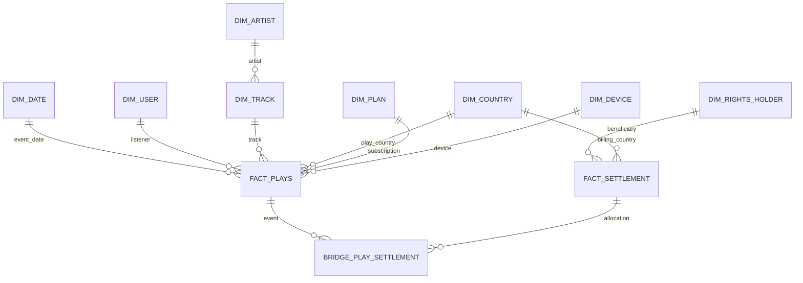

# EG-31 — Dimensional model and Data Lake / Modelo dimensional y Data Lake

**Status / Estado:** Proposed design / Diseño propuesto — 2026-10-21. This is a design contract, **not** evidence that Spark tables or Parquet partitions are deployed.

## English

### Grain and keys

- `fact_plays`: **one incoming F2 play/event per `event_id`**, including rejected and valid plays. `event_id` is the immutable unique business key; retain `source_event_id`, `ingested_at_utc`, `event_at_utc`, `validity_status` (valid/invalid), `invalid_reason`, `offline_flag`, `duration_seconds`, `session_id`, and `settlement_id` (nullable UUID until paid). `settlement_id` references `liquidaciones.liquidacion_id` from `db/ddl/003_reportes_regalias.sql`. Reprocessing must not create another row for the same event. A rejected play must not be assigned to a settlement.
- `fact_settlement`: **one rights holder × billing country × settlement month × settlement version × pool component × contract percentage**. The requested grain rights holder × country × month × version is the reporting aggregation grain; component and contract percentage are additional detail required by the existing `reporte_regalias` primary key (a holder can have more than one contractual percentage in a month). Unique business key: `settlement_id, rights_holder_id, country_code, component, contract_percentage`. `settlement_type`: original/adjustment; `parent_settlement_id` nullable for append-only corrections. Measures: valid_plays, pool_usd, participation, contract_percentage, royalty_usd (numeric with 2 decimals, half-up). `settlement_id` and `period_start` must match `liquidaciones`.
- The bridge `bridge_play_settlement(event_id, settlement_id, rights_holder_id, component, allocation_usd)` is **proposed** to preserve many-to-many traceability when a play contributes to multiple holders/components. `fact_plays.settlement_id` remains the primary published settlement identifier required by RNF-03; additional allocations live in the bridge. A new settlement version must never overwrite an older published version.
- Dimensions: `dim_date(date_key, calendar_date, year, month, day)`, `dim_user(user_key, source_user_id)`, `dim_track(track_key, source_track_id, artist_key)`, `dim_artist(artist_key, source_artist_id)`, `dim_rights_holder(rights_holder_key, source_holder_id)`, `dim_country(country_key, iso_alpha2, region)`, `dim_plan(plan_key, plan_code)`, `dim_device(device_key, device_type)`. Prefer surrogate keys in analytical tables; retain stable source IDs. Define effective dates for changes in contract/ownership when implementing historical joins.
- The `billing_country` used for settlement must be distinguished from playback country; define both as separate role-playing references to `dim_country` where applicable.

### Conceptual relationships

### Data Lake and analytics

- **Bronze:** immutable original F2 events and source snapshots F1/F3/F4/F5/F6/F7; keep raw payload and ingestion metadata. Persist first; ACK RabbitMQ only after durable write.
- **Silver:** validated and deduplicated Parquet, with RN-01–RN-04 statuses, normalized IDs and event timestamps. Partition by `year=YYYY/month=MM/country=CC` when country exists; do not infer a country from missing data.
- **Gold:** `fact_plays`, `fact_settlement`, dimensions, fraud aggregates, churn/cohort and engagement outputs in Parquet; partition fact datasets by year/month/country. A published settlement version is immutable.
- **Churn/cohorts (RN-09):** derive monthly subscriber active/renewal/cancellation status from F3, retain cohort month, compare active users across consecutive months. Do not infer churn solely from a lack of plays.
- **Engagement:** session-level `SUM(valid_duration_seconds)/3600` for hours, `COUNT(DISTINCT track_id)` for tracks per session; explicitly exclude invalid plays from paid-play measures. Define session boundaries from F2 `session_id` or an approved inactivity threshold.
- **Reconciliation:** compare `COUNT(DISTINCT event_id)` in Silver with Gold plays by month; compare Gold settlement totals by holder/country/component/contract percentage with `reporte_regalias`; check that every paid play references a published `liquidaciones` record. Keep audit evidence for each run.

**Dependencies / review:** EG-30 source contracts; EG-35 Silver implementation; EG-37 Gold implementation; EG-42 churn; EG-44 Power BI. See [ADR-0014 proposal](../adr/0014-data-lake-parquet-partitions.md), [API reporting schema](../../db/ddl/003_reportes_regalias.sql) and [architecture v1](../arquitectura/arquitectura-v1.md).

### Acceptance checklist

1. Diagram and eight dimensions: **documented proposal**.
2. Settlement grain and original/adjustment versioning: **documented proposal**.
3. Paid play carries settlement ID: **documented field and integrity contract, not yet implemented**.
4. Bronze/Silver/Gold Parquet partitions and ADR-0014: **documented proposal**.
5. Churn and engagement: **query-ready design, not yet validated on real pipeline**.

---

## Español

**Estado:** diseño propuesto, todavía no implementado en Spark ni desplegado en AWS.

### Granularidad y claves

- `fact_plays`: **una fila por reproducción/evento F2** identificado por `event_id`, válida o rechazada. Incluye fecha UTC, usuario, canción, artista, país, plan, dispositivo, sesión, duración, estado de validez, motivo de rechazo, indicador offline y `settlement_id` (UUID nulo hasta la liquidación). Un reintento no puede duplicar el evento; las reproducciones inválidas no se liquidan.
- `fact_settlement`: **titular × país de facturación × mes × versión × componente × porcentaje contractual**. El grano solicitado por Jira (titular × país × mes × versión) corresponde a la agregación; se agregan componente y porcentaje porque el DDL de la API permite varios porcentajes contractuales para un titular en un mes. Se conserva cada versión como registro nuevo (original o ajuste), sin sobrescribir liquidaciones anteriores.
- `bridge_play_settlement`: tabla puente **propuesta** entre reproducciones y liquidaciones para permitir trazabilidad de una reproducción que aporta a varios titulares/componentes. El campo `fact_plays.settlement_id` conserva la referencia principal requerida por RNF-03.
- Dimensiones: fecha, usuario, canción, artista, titular, país, plan y dispositivo. Se conservan los identificadores de origen. El país de reproducción y el de facturación se tratan por separado.

### Capas y consultas

- **Bronze:** eventos originales y copias de fuentes, inmutables.
- **Silver:** Parquet normalizado, sin duplicados y con las reglas RN-01 a RN-04.
- **Gold:** hechos, dimensiones, resultados de fraude, churn, cohortes y engagement. Particiones `year/month/country` donde aplique.
- **Churn:** calcular bajas o inactividad de suscripciones con F3; no concluir cancelación solo por ausencia de reproducciones.
- **Engagement:** horas reproducidas válidas y canciones distintas por sesión.
- **Control:** reconciliar eventos Silver/Gold, totales de regalías con `reporte_regalias` y referencias a liquidaciones publicadas.

**Pendiente para cerrar EG-31:** aprobación del diseño, materialización de tablas, validación de integridad y consultas sobre datos reales. Las cinco condiciones de Jira quedan descritas como diseño, no como ejecución comprobada.
