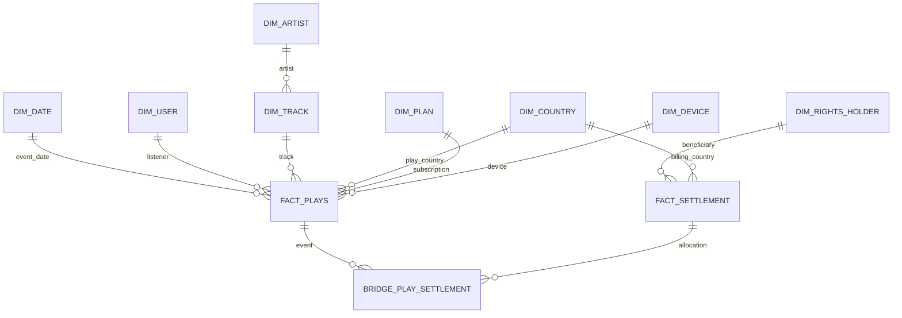

# EG-31 — Dimensional model and Data Lake / Modelo dimensional y Data Lake

> **Design precedence / Precedencia:** The section **Design correction v2** below supersedes earlier references to one Gold row per F2 event, the earlier `fact_settlement` detail grain, and event-based Gold SQL checks. / La sección **Corrección de diseño v2** reemplaza esas definiciones anteriores. Earlier SQL is illustrative only and must be adapted to `play_id` before execution.


**Status / Estado:** Proposed design / Diseño propuesto — 2026-10-21. This is a design contract, **not** evidence that Spark tables or Parquet partitions are deployed.

## English

### Grain and keys

- `fact_plays`: **one incoming F2 play/event per `event_id`**, including rejected and valid plays. `event_id` is the immutable unique business key; retain `source_event_id`, `ingested_at_utc`, `event_at_utc`, `validity_status` (valid/invalid), `invalid_reason`, `offline_flag`, `duration_seconds`, `session_id`, and `settlement_id` (nullable UUID until paid). `settlement_id` references `liquidaciones.liquidacion_id` from `db/ddl/003_reportes_regalias.sql`. Reprocessing must not create another row for the same event. A rejected play must not be assigned to a settlement.
- `fact_settlement`: **one rights holder × billing country × settlement month × settlement version × pool component × contract percentage**. The requested grain rights holder × country × month × version is the reporting aggregation grain; component and contract percentage are additional detail required by the existing `reporte_regalias` primary key (a holder can have more than one contractual percentage in a month). Unique business key: `settlement_id, rights_holder_id, country_code, component, contract_percentage`. `settlement_type`: original/adjustment; `parent_settlement_id` nullable for append-only corrections. Measures: valid_plays, pool_usd, participation, contract_percentage, royalty_usd (numeric with 2 decimals, half-up). `settlement_id` and `period_start` must match `liquidaciones`.
- The bridge `bridge_play_settlement(event_id, settlement_id, rights_holder_id, component, allocation_usd)` is **proposed** to preserve many-to-many traceability when a play contributes to multiple holders/components. `fact_plays.settlement_id` remains the primary published settlement identifier required by RNF-03; additional allocations live in the bridge. A new settlement version must never overwrite an older published version.
- Dimensions: `dim_date(date_key, calendar_date, year, month, day)`, `dim_user(user_key, source_user_id)`, `dim_track(track_key, source_track_id, artist_key)`, `dim_artist(artist_key, source_artist_id)`, `dim_rights_holder(rights_holder_key, source_holder_id)`, `dim_country(country_key, iso_alpha2, region)`, `dim_plan(plan_key, plan_code)`, `dim_device(device_key, device_type)`. Prefer surrogate keys in analytical tables; retain stable source IDs. Define effective dates for changes in contract/ownership when implementing historical joins.
- The `billing_country` used for settlement must be distinguished from playback country; define both as separate role-playing references to `dim_country` where applicable.

### Conceptual relationships



### Data Lake and analytics

- **Bronze:** immutable original F2 events and source snapshots F1/F3/F4/F5/F6/F7; keep raw payload and ingestion metadata. Persist first; ACK RabbitMQ only after durable write.
- **Silver:** validated and deduplicated Parquet, with RN-01–RN-04 statuses, normalized IDs and event timestamps. Partition by `year=YYYY/month=MM/country=CC` when country exists; do not infer a country from missing data.
- **Gold:** `fact_plays`, `fact_settlement`, dimensions, fraud aggregates, churn/cohort and engagement outputs in Parquet; partition fact datasets by year/month/country. A published settlement version is immutable.
- **Churn/cohorts (RN-09):** derive monthly subscriber active/renewal/cancellation status from F3, retain cohort month, compare active users across consecutive months. Do not infer churn solely from a lack of plays.
- **Engagement:** session-level `SUM(valid_duration_seconds)/3600` for hours, `COUNT(DISTINCT track_id)` for tracks per session; explicitly exclude invalid plays from paid-play measures. Define session boundaries from F2 `session_id` or an approved inactivity threshold.
- **Reconciliation:** compare `COUNT(DISTINCT event_id)` in Silver with Gold plays by month; compare Gold settlement totals by holder/country/component/contract percentage with `reporte_regalias`; check that every paid play references a published `liquidaciones` record. Keep audit evidence for each run.

**Dependencies / review:** EG-30 source contracts; EG-35 Silver implementation; EG-37 Gold implementation; EG-42 churn; EG-44 Power BI. See [ADR-0014 proposal](../adr/0014-data-lake-parquet-partitions.md), [API reporting schema](../../db/ddl/003_reportes_regalias.sql) and [architecture v1](../arquitectura/arquitectura-v1.md).

### Acceptance checklist

1. Diagram and eight dimensions: **documented proposal**.
2. Settlement grain and original/adjustment versioning: **documented proposal**.
3. Paid play carries settlement ID: **documented field and integrity contract, not yet implemented**.
4. Bronze/Silver/Gold Parquet partitions and ADR-0014: **documented proposal**.
5. Churn and engagement: **query-ready design, not yet validated on real pipeline**.

---

## Español

**Estado:** diseño propuesto, todavía no implementado en Spark ni desplegado en AWS.

### Granularidad y claves

- `fact_plays`: **una fila por reproducción/evento F2** identificado por `event_id`, válida o rechazada. Incluye fecha UTC, usuario, canción, artista, país, plan, dispositivo, sesión, duración, estado de validez, motivo de rechazo, indicador offline y `settlement_id` (UUID nulo hasta la liquidación). Un reintento no puede duplicar el evento; las reproducciones inválidas no se liquidan.
- `fact_settlement`: **titular × país de facturación × mes × versión × componente × porcentaje contractual**. El grano solicitado por Jira (titular × país × mes × versión) corresponde a la agregación; se agregan componente y porcentaje porque el DDL de la API permite varios porcentajes contractuales para un titular en un mes. Se conserva cada versión como registro nuevo (original o ajuste), sin sobrescribir liquidaciones anteriores.
- `bridge_play_settlement`: tabla puente **propuesta** entre reproducciones y liquidaciones para permitir trazabilidad de una reproducción que aporta a varios titulares/componentes. El campo `fact_plays.settlement_id` conserva la referencia principal requerida por RNF-03.
- Dimensiones: fecha, usuario, canción, artista, titular, país, plan y dispositivo. Se conservan los identificadores de origen. El país de reproducción y el de facturación se tratan por separado.

### Capas y consultas

- **Bronze:** eventos originales y copias de fuentes, inmutables.
- **Silver:** Parquet normalizado, sin duplicados y con las reglas RN-01 a RN-04.
- **Gold:** hechos, dimensiones, resultados de fraude, churn, cohortes y engagement. Particiones `year/month/country` donde aplique.
- **Churn:** calcular bajas o inactividad de suscripciones con F3; no concluir cancelación solo por ausencia de reproducciones.
- **Engagement:** horas reproducidas válidas y canciones distintas por sesión.
- **Control:** reconciliar eventos Silver/Gold, totales de regalías con `reporte_regalias` y referencias a liquidaciones publicadas.

**Pendiente para cerrar EG-31:** aprobación del diseño, materialización de tablas, validación de integridad y consultas sobre datos reales. Las cinco condiciones de Jira quedan descritas como diseño, no como ejecución comprobada.


## Traceability and delivery sequence / Trazabilidad y secuencia de entrega

| Requirement / Requisito | Source → transformation → destination / Fuente → transformación → destino | Verification / Verificación | Owner / Responsable |
|---|---|---|---|
| EG-31 CA1; F2, RN-01/02/03/04 | F2 JSON → EG-29/33 Bronze → EG-35/36 Silver → `fact_plays` Gold | one event_id per play; all eight dimensions linked or explicit unknown member | María Clara |
| EG-31 CA2; RF-09, EG-23 | F3 subscriptions + F4 contracts + F5/F6/F7 → EG-37 settlement → `fact_settlement` + `reporte_regalias` | holder × billing country × month × version reconciliation; original/adjustment immutable | Andrea / María Clara |
| EG-31 CA3; RNF-03 | `fact_plays.event_id` → `bridge_play_settlement` → `liquidaciones.liquidacion_id` | valid paid events reference published settlement; invalid events have null settlement_id | María Clara / Andrea |
| EG-31 CA4; ADR-0014, EG-26/33 | RabbitMQ → S3 Bronze → Spark Silver → Spark Gold | Parquet partitions by year/month/country; rerun stable counts; S3 encrypted/private | Julián / Andrea / María Clara |
| EG-31 CA5; RN-09, EG-42/44 | F3 subscription states + F2 valid sessions → Gold cohort and engagement marts → Power BI | sample cohort churn and hours/tracks per session match hand-calculated values | María Clara |
| EG-32 CA1/2; E-07 | EG-26 Terraform inventory → AWS Pricing Calculator → 24/7 vs test windows | exported shareable estimate + priced per-service assumptions | María Clara / Julián |
| EG-32 CA3/4/5; E-07 | AWS Budget/SNS + Terraform Project/Owner tags → Cost Explorer → `docs/costos/` | test notification, verified tags and architecture link | Julián / María Clara |

**Implementation order / Orden:** EG-26 and EG-29 unblock EG-33; EG-30 and EG-31 define source and analytical contracts; EG-33 feeds EG-35; EG-35 and EG-36 feed EG-37; EG-37 feeds EG-38 and EG-45; EG-42/43 feed EG-44. EG-32 controls AWS spending across every infrastructure step.

### Executable verification contract / Contrato de verificación ejecutable

The following are **checks to implement in EG-35/37**, not claims of passed tests:

```sql
-- CA1: no duplicated source play after replay
SELECT event_id, COUNT(*) FROM fact_plays GROUP BY event_id HAVING COUNT(*) > 1;

-- CA3: rejected plays are never paid
SELECT event_id FROM fact_plays
WHERE validity_status = 'invalid' AND settlement_id IS NOT NULL;

-- CA3: every settlement referenced by a paid play exists and is published
SELECT p.event_id FROM fact_plays p
LEFT JOIN liquidaciones l ON l.liquidacion_id = p.settlement_id
WHERE p.settlement_id IS NOT NULL AND (l.liquidacion_id IS NULL OR l.publicada_en IS NULL);

-- CA2: settlement detail must have a version and recognized type
SELECT settlement_id FROM fact_settlement
WHERE settlement_version IS NULL OR settlement_type NOT IN ('original', 'adjustment');
```

**Important:** SQL is conceptual and assumes future Gold tables exist in a SQL-accessible catalog; do not execute against the current PostgreSQL reporting schema as-is. Its existing tables are `liquidaciones` and `reporte_regalias`, not the proposed Gold facts.

### Evidencia y consecutividad

Los criterios de EG-31 se consideran **diseñados y trazados**, pero solo estarán **aceptados** cuando exista ejecución de Spark/Parquet y pruebas reproducibles. No confundir el esquema de reportes de PostgreSQL (`db/ddl/003_reportes_regalias.sql`) con el esquema analítico Gold. EG-37 debe publicar versiones de liquidación sin sobrescribirlas, y EG-45 debe conciliar la salida de Gold con la API.

Los controles SQL anteriores son **contratos de prueba pendientes de implementación**; no son resultados de pruebas reales. Las dependencias siguen el orden de historias y evitan marcar EG-31 como terminada antes de integrar sus consumidores.


## Design correction v2 — authoritative grain and lineage (English)

**Scope:** EG-31 is a design deliverable. These are proposed contracts for EG-35/37; no Spark execution or deployment is asserted.

### Event versus play (CA1)

An F2 transport message is **not automatically one billable play**. Bronze stores each raw message with `event_id` as its transport idempotency key. Silver maintains `silver_events` at one row per unique `event_id` and reconstructs `silver_plays` at **one row per logical play** using a stable `play_id` (from the source if present; otherwise a deterministic, versioned reconstruction key defined and tested in EG-35). START/PAUSE/RESUME/END messages belonging to the same play must not multiply paid counts. Missing END, offline timestamps, retries and late arrivals follow EG-35 and RN-01/02/04. Preserve `bridge_play_event(play_id,event_id)` to audit all contributing source messages.

**Corrected Gold grain:** `fact_plays` is **one row per reconstructed `play_id`**, including valid and invalid plays. Unique key `play_id`; include `validity_status`, `invalid_reason`, `duration_seconds`, `session_id`, `event_date_key`, `user_key`, `track_key`, `play_country_key`, `plan_key`, `device_key`, `offline_flag`, `source_event_count`, `source_play_id`, `rule_version`, `settlement_id` nullable, and `paid_status` (unpaid/paid). `event_id` belongs in `silver_events` and the bridge, not as the unique Gold play key. Artist is reachable via `dim_track.artist_key`; rights holder via versioned ownership/contract allocation to avoid assigning a single holder where multiple rights exist. The eight required dimensions remain date, user, track, artist, rights holder, country, plan and device.

**CA3 and settlement history:** `fact_plays.settlement_id` is the **primary currently published settlement** for a paid play, null for unpaid or invalid plays. Because a play can allocate to multiple holders and later adjustments, the append-only `bridge_play_settlement(play_id,settlement_id,rights_holder_id,component,contract_percentage,allocation_usd,allocation_type)` preserves every allocation and version; do not overwrite earlier bridge rows. `settlement_id` references the published batch `liquidaciones.liquidacion_id`, not a row in `reporte_regalias`. Enforce one canonical primary published settlement per paid play under an explicit publication policy; adjustments retain their separate settlement IDs in the bridge. If this policy cannot be guaranteed, the team must approve a versioned current-settlement view instead of pretending a scalar field captures all historical allocations.

### Settlement grain and financial controls (CA2)

**Jira reporting grain:** holder × billing country × UTC settlement month × published settlement version. Define a **reporting view** `fact_settlement` at that grain with `royalty_usd = SUM(detail.royalty_usd)` and `valid_plays = COUNT(DISTINCT eligible play_id)` (not a sum of repeated counts across components). Maintain `fact_settlement_detail` at holder × billing country × month × version × component × contract percentage to map losslessly to `reporte_regalias`. Use `settlement_id` as immutable batch/version ID and `settlement_type` original/adjustment, with nullable `parent_settlement_id`. **Do not sum repeated country-level pool values across holders, components or contract bands**: hold pool totals in a separate `fact_country_pool(period,country,component,pool_usd)` and reconcile once per country/component/version. Contract effective dates and ownership must be joined as-of play time (or the formally approved contractual effective time), not using current ownership. A correction creates a new published version and preserves prior versions.

### Proposed validation gates (not executed)

1. `COUNT(*) = COUNT(DISTINCT play_id)` in Gold; `COUNT(*) = COUNT(DISTINCT event_id)` in Silver events; every bridge event references exactly one reconstructed play or an explicit quarantine reason.
2. Each valid paid play has a published canonical `settlement_id`; invalid or unpaid plays have null; each bridge allocation resolves to a published settlement, a valid play, and an effective contract.
3. Sum detail royalties to the holder-country-month-version reporting view, and compare detail to PostgreSQL `reporte_regalias` using its composite key. Country/component royalties must not exceed the corresponding pool beyond USD 0.01 after approved rounding.
4. Rerunning the same `run_id` yields no new plays, details or allocations; corrections append a new settlement version and do not mutate the old version.
5. EG-42 churn uses paying subscribers at the start of the month as denominator; plan migrations are not churn, free subscribers are excluded. Engagement uses valid listened seconds / 3600 and distinct tracks per user/session/month; compare sample outputs to manual calculations.

**Sequential gate:** EG-31 contract review → EG-33 Bronze → EG-35 reconstructed Silver plays + EG-36 fraud → EG-37 Gold and settlement publication → EG-42/44 analytics. EG-30 F5/F6/F7 and EG-23 settlement fixtures are required inputs to EG-37. Approval of this design does not certify the downstream implementations.

## Corrección de diseño v2 — granularidad y linaje (Español)

**Alcance:** EG-31 entrega el diseño. Los siguientes contratos son propuestos para EG-35/37; no constituyen pruebas Spark ejecutadas.

**Eventos frente a reproducciones (CA1).** Un mensaje F2 no equivale necesariamente a una reproducción pagable. Bronze conserva el mensaje original y su `event_id`; Silver deduplica `silver_events` por `event_id` y reconstruye `silver_plays` con una fila por reproducción lógica `play_id`. Los eventos START/PAUSE/RESUME/END de una reproducción no pueden multiplicar regalías. Si la fuente no proporciona `play_id`, EG-35 debe definir y probar una clave determinista versionada. `bridge_play_event(play_id,event_id)` conserva el linaje; eventos incompletos y tardíos siguen RN-01/02/04.

**Grano Gold corregido.** `fact_plays` tiene **una fila por `play_id`**, válida o inválida, con estado, duración, sesión, claves dimensionales, versión de reglas y `settlement_id` nulo hasta el pago. Las ocho dimensiones exigidas siguen siendo fecha, usuario, canción, artista, titular, país, plan y dispositivo. Artista se relaciona por canción; titulares y contratos deben resolverse con vigencia histórica.

**Trazabilidad (CA3).** `settlement_id` identifica la liquidación principal publicada para una reproducción pagada, no una fila del reporte. La tabla puente `bridge_play_settlement` conserva asignaciones a múltiples titulares, componentes y versiones, incluidos ajustes; no se sobrescriben filas anteriores. Si no es posible definir una liquidación principal única, debe aprobarse una vista versionada en lugar de fingir que un único campo representa todo el historial.

**Grano de liquidación (CA2).** `fact_settlement` será una vista agregada por titular × país de facturación × mes UTC × versión. `fact_settlement_detail` conserva componente y porcentaje contractual para reconciliar con `reporte_regalias`. Las reproducciones válidas se cuentan de forma distinta, sin sumarlas dos veces por componente. La bolsa se almacena aparte en `fact_country_pool` y **no se suma repetidamente por titular**. Los contratos se unen por vigencia; las correcciones agregan versiones nuevas sin modificar las anteriores.

**Pruebas pendientes:** unicidad de `play_id` y `event_id`; integridad de ambas tablas puente; liquidaciones publicadas para pagos válidos; reconciliación de regalías con PostgreSQL y bolsa (tolerancia USD 0,01); idempotencia por `run_id`; churn sin contar cambios de plan ni usuarios gratuitos; engagement comparado con un cálculo manual. Ninguna se declara aprobada.

**Orden:** revisión EG-31 → EG-33 Bronze → EG-35/36 Silver/fraude → EG-37 Gold/liquidación → EG-42/44 analítica. EG-30 y EG-23 alimentan EG-37. La aprobación del diseño no equivale a aceptar la implementación.
