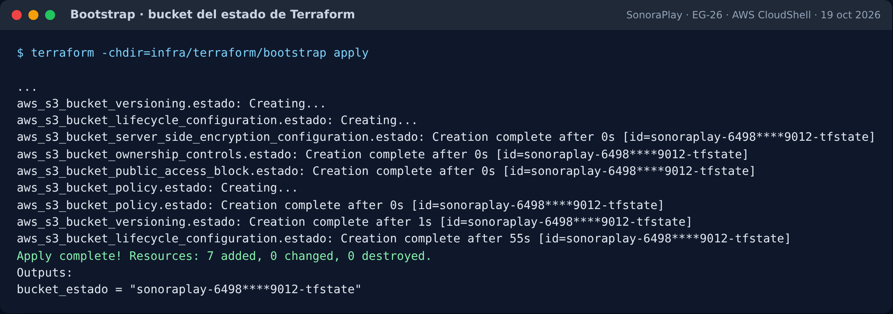
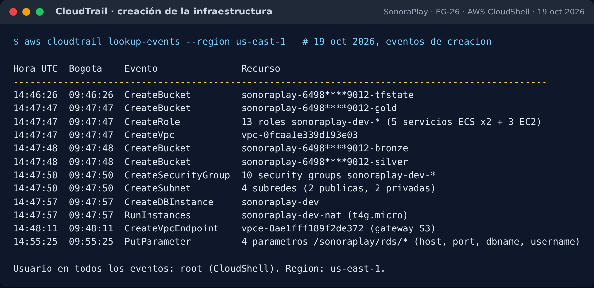
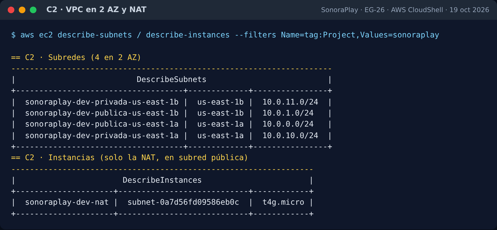
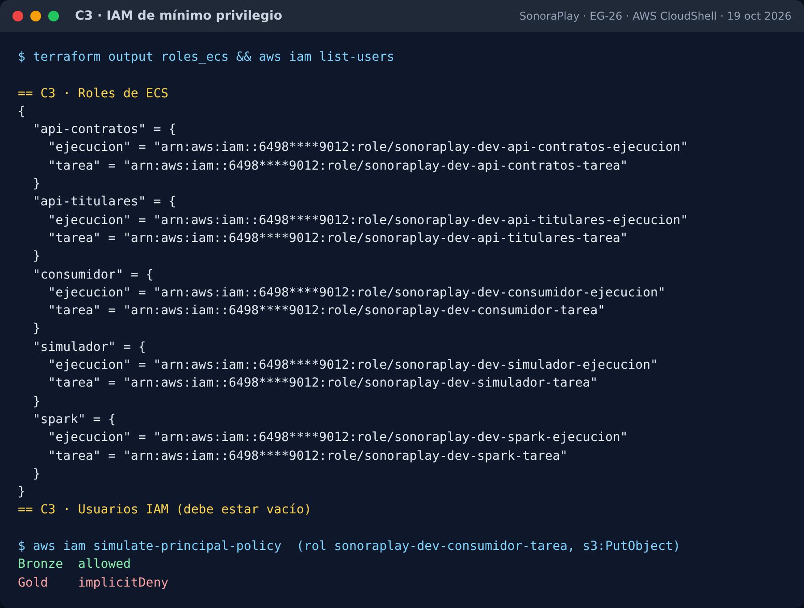
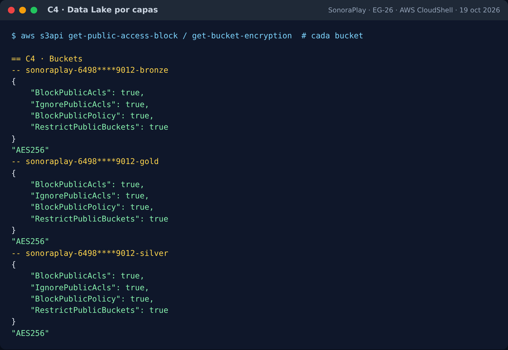
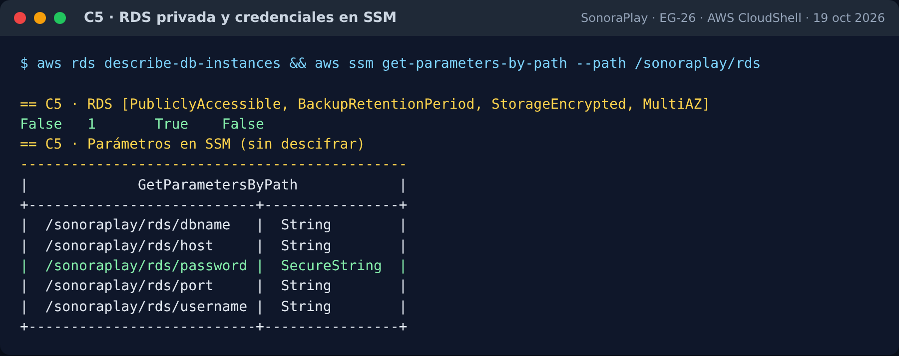
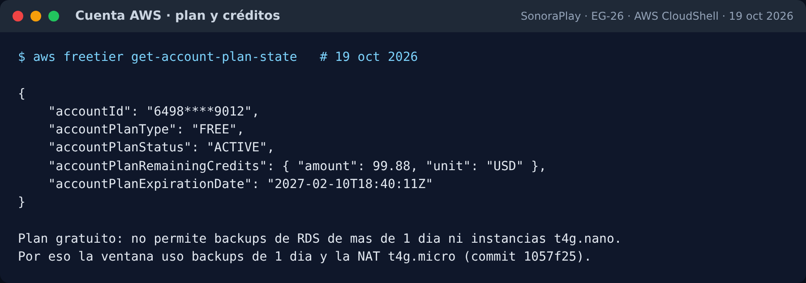
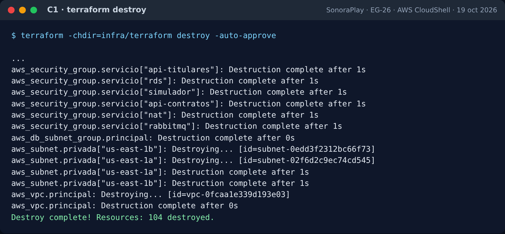
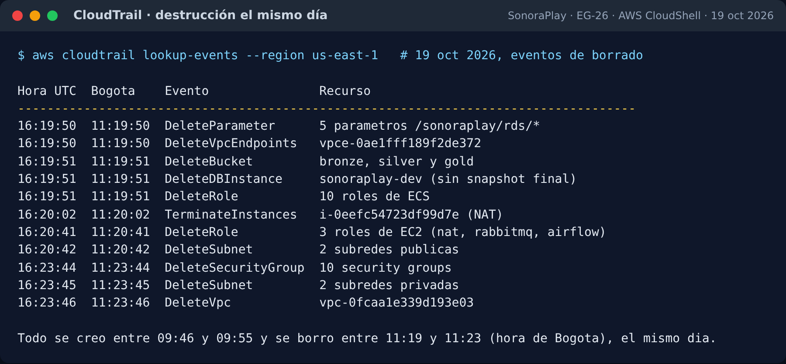
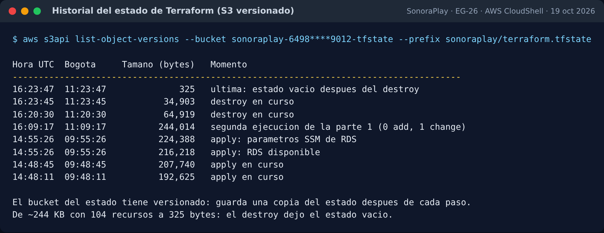

# EG-26 · IAM, VPC, S3 por capas y RDS: evidencia en AWS / AWS evidence

## Español

**Sprint 3 · HU 17 · Entregable E-06.** Esta página reúne la prueba de que el Terraform de la EG-26 crea la infraestructura base en AWS, cumple los criterios de aceptación y se destruye sin dejar recursos huérfanos.

| Dato | Valor |
|---|---|
| Fecha de la ventana | 19 oct 2026, de 09:46 a 11:23 (hora de Bogotá) |
| Cuenta / región | `6498****9012` / `us-east-1` |
| Código | Rama `feature/EG-26-iam-vpc-s3-rds`, commit `1057f25` |
| Ejecución | AWS CloudShell, Terraform 1.16.6 |
| Política | Ventana de encendido: `apply` → verificar → `destroy` el mismo día ([ADR-0020](../adr/0020-ventanas-encendido-aws.md)) |

Las imágenes muestran la salida real de los comandos, en español. El ID de la cuenta está enmascarado y ninguna imagen contiene la contraseña de RDS.

### Resumen por criterio

| Criterio | Resultado | Evidencia |
|---|---|---|
| **C1** · `apply` y `destroy` sin huérfanos | ✅ | CloudTrail, historial del estado y `Destroy complete! Resources: 104 destroyed.` |
| **C2** · VPC en 2 AZ con subredes públicas y privadas | ✅ | 4 subredes /24 en us-east-1a y us-east-1b; solo la NAT en una subred pública |
| **C3** · Un rol de mínimo privilegio por servicio, sin llaves | ✅ | 13 roles, 0 usuarios IAM; el consumidor escribe en Bronze y no en Gold |
| **C4** · Bronze, Silver y Gold privados y cifrados | ✅ | Block Public Access completo y `AES256` |
| **C5** · RDS privada, backups de 7 días, credenciales en SSM | ⚠️ | Privada y cifrada, contraseña como `SecureString`; **backups de 1 día** por el plan gratuito, excepción pendiente de aprobación (ver abajo) |
| **C6** · ADR-0009, 0010 y 0011 | ✅ | Escritos en la rama de la EG-26 |

### Puntos abiertos

:::warning Excepción del criterio C5: pendiente de aprobación
La cuenta de AWS del proyecto está en el **plan gratuito**, que rechaza RDS con más de 1 día de backups (`FreeTierRestrictionError`) y no permite instancias `t4g.nano`. Por eso el commit `1057f25` usa `rds_backup_retention_days = 1` y la NAT `t4g.micro`. El criterio C5 pide 7 días, así que **esta excepción debe aprobarla Julián** antes de dar la historia por terminada. Si no se acepta, hay dos caminos: pasar la cuenta a plan pago (los créditos se conservan) y volver a poner 7 días y `t4g.nano` sin otros cambios, o repetir la ventana en una cuenta con plan pago.
:::

| Ajuste | Estado | Dónde se resuelve |
|---|---|---|
| La contraseña de RDS y la de SSM se desincronizan tras un `apply` parcial | **Sin resolver en el código.** En la ventana se corrigió a mano con `terraform apply -var rds_password_version=2` | En la misma EG-26, antes de fusionar su rama: `depends_on = [aws_db_instance.principal]` en `aws_ssm_parameter.rds_password` |
| `rds.force_ssl` aparece como cambio en cada `plan` | **Sin resolver.** Es cosmético: el valor sigue en `1` y no reinicia nada | En la misma EG-26: `apply_method = "pending-reboot"` en el bloque `parameter` de `rds.tf` |

Ninguno de los dos cambia lo que muestra esta evidencia. Por eso esta página puede fusionarse sin ellos, y los dos ajustes quedan como condición para fusionar la rama de infraestructura de la EG-26.

### 1. Creación (`apply`)

Primero se crea, una sola vez, el bucket donde Terraform guarda su estado. Es el único recurso que se queda entre ventanas.



CloudTrail, el registro de auditoría de AWS, muestra cada recurso creado por el `apply` en unos 10 minutos. RDS es lo que más tarda.



### 2. Verificación de los criterios

#### C2 · Red

Cuatro subredes en dos zonas de disponibilidad. La única máquina es la instancia NAT (ADR-0010), en una subred pública.



#### C3 · IAM

Cada servicio de ECS tiene un rol de ejecución y uno de tarea, y la cuenta no tiene usuarios IAM, así que no hay access keys. La simulación de políticas confirma el mínimo privilegio: el consumidor puede escribir en Bronze, y Gold le queda denegado.



#### C4 · Data Lake por capas



#### C5 · RDS y SSM

La base no tiene IP pública, está cifrada y vive en una sola zona. Las credenciales están en SSM Parameter Store; la contraseña es `SecureString` y se lista sin descifrar.





### 3. Destrucción el mismo día (`destroy`)

El `destroy` borra los 104 recursos del stack. Los buckets se vacían antes de borrarse y RDS no deja snapshot final (`destruccion_limpia = true`).



CloudTrail confirma el borrado de cada recurso entre las 11:19 y las 11:23 (hora de Bogotá).



El estado de Terraform tiene versionado en S3, así que se ve su historia completa: crece con el `apply` y queda vacío (325 bytes) después del `destroy`.



#### Sin huérfanos

Después del `destroy` se revisó cada servicio directamente: EC2, EBS, RDS (instancias, snapshots, backups automáticos, parameter y subnet groups), VPC, subredes, endpoints, interfaces de red, IP elásticas, security groups, CloudWatch, SSM e IAM. **No quedó ninguno.** Solo queda el bucket del estado, que es persistente por diseño.

:::info Por qué `verificar-huerfanos.sh` listó recursos
El script consulta la API de etiquetas de AWS (Resource Groups Tagging), que tarda varios minutos en olvidar lo que se borró. Justo después del `destroy` todavía nombraba la NAT y su volumen, que ya no existían. La revisión servicio por servicio y CloudTrail son la prueba confiable.
:::

### 4. Hallazgos de la ventana

| Hallazgo | Causa | Arreglo |
|---|---|---|
| RDS y la NAT no se crearon en el primer `apply` | Restricciones del plan gratuito | NAT `t4g.micro` y backups de 1 día (commit `1057f25`) |
| Una regla de SG falló | La descripción tenía `%`, que AWS no acepta | Cambiado a "porcentaje" (commit `1057f25`) |
| `password authentication failed` tras un `apply` parcial | La contraseña efímera se regenera en cada `apply` y SSM no se reescribe | Ver "Puntos abiertos" |
| El parameter group aparece cambiado en cada plan | AWS guarda `rds.force_ssl` como `pending-reboot` | Ver "Puntos abiertos" |
| CloudShell sin espacio | `$HOME` tiene 1 GB y el proveedor de AWS pesa cientos de MB | Código y proveedores en `/tmp` con `TF_PLUGIN_CACHE_DIR` |

### 5. Prueba adicional: el pipeline sobre la infraestructura

En la ventana del 15 de octubre se corrió el esqueleto ([EG-24](../esqueleto.md)) contra la RDS privada, desde un entorno de CloudShell dentro de la VPC (subred privada y SG `airflow`):

- se cargaron 10.000 usuarios, 8.712 suscripciones, 69.227 pagos, 50 titulares y 208 contratos;
- se publicó la liquidación de 2026-09 para Colombia en `reporte_regalias`;
- se subieron `f1/` y `f2/fecha=2026-09-30/` al bucket Bronze.

Eso confirma que la red privada, la NAT, el endpoint de S3, la regla `airflow → rds` y las credenciales en SSM funcionan juntos.

### Cómo repetir la ventana

```bash
# Parte 1: crear y verificar (unos 15 min)
bash ventana-eg26-parte1-crear.sh
# Parte 2: destruir el mismo día
bash ventana-eg26-parte2-destruir.sh
```

Los dos scripts se corren en AWS CloudShell (us-east-1) y guardan la evidencia en `~/evidencia-eg26`.

## English

**Sprint 3 · User story 17 · Deliverable E-06.** This page collects the proof that the EG-26 Terraform code creates the base AWS infrastructure, meets the acceptance criteria and is destroyed without leaving orphan resources.

| Item | Value |
|---|---|
| Test window | 19 Oct 2026, 09:46 to 11:23 (Bogotá time, UTC−5) |
| Account / region | `6498****9012` / `us-east-1` |
| Code | Branch `feature/EG-26-iam-vpc-s3-rds`, commit `1057f25` |
| Run from | AWS CloudShell, Terraform 1.16.6 |
| Policy | Power-on window: `apply` → verify → `destroy` on the same day ([ADR-0020](../adr/0020-ventanas-encendido-aws.md)) |

The images show the actual command output; labels and comments in them are in Spanish. The account ID is masked, and no image contains the RDS password.

### Summary by criterion

| Criterion | Result | Evidence |
|---|---|---|
| **C1** · `apply` and `destroy` with no orphans | ✅ | CloudTrail, Terraform state history and `Destroy complete! Resources: 104 destroyed.` |
| **C2** · VPC across 2 AZs with public and private subnets | ✅ | 4 /24 subnets in us-east-1a and us-east-1b; only the NAT is in a public subnet |
| **C3** · One least-privilege role per service, no keys | ✅ | 13 roles, 0 IAM users; the consumer can write to Bronze but not to Gold |
| **C4** · Private, encrypted Bronze, Silver and Gold | ✅ | Full Block Public Access and `AES256` |
| **C5** · Private RDS, 7-day backups, credentials in SSM | ⚠️ | Private and encrypted, password as `SecureString`; **1-day backups** because of the free plan, exception pending approval (see below) |
| **C6** · ADR-0009, 0010 and 0011 | ✅ | Written in the EG-26 branch |

### Open items

:::warning C5 exception: pending approval
The project's AWS account is on the **free plan**, which rejects RDS with more than 1 day of backups (`FreeTierRestrictionError`) and does not allow `t4g.nano` instances. That is why commit `1057f25` uses `rds_backup_retention_days = 1` and a `t4g.micro` NAT. Criterion C5 asks for 7 days, so **Julián must approve this exception** before the story is marked done. If it is not accepted, there are two options: upgrade the account to a paid plan (remaining credits are kept) and set 7 days and `t4g.nano` back with no other changes, or repeat the window in an account on a paid plan.
:::

| Fix | Status | Where it is handled |
|---|---|---|
| RDS and SSM passwords drift apart after a partial `apply` | **Not fixed in the code yet.** It was fixed by hand during the window with `terraform apply -var rds_password_version=2` | In EG-26 itself, before its branch is merged: `depends_on = [aws_db_instance.principal]` on `aws_ssm_parameter.rds_password` |
| `rds.force_ssl` shows as a change on every `plan` | **Not fixed yet.** It is cosmetic: the value stays `1` and nothing reboots | In EG-26 itself: `apply_method = "pending-reboot"` in the `parameter` block of `rds.tf` |

Neither fix changes what this evidence shows. This page can therefore be merged without them, and both fixes become a condition for merging the EG-26 infrastructure branch.

### 1. Creation (`apply`)

First, the bucket that stores the Terraform state is created once. It is the only resource kept between windows (bootstrap image above).

CloudTrail, the AWS audit log, records every resource created by the `apply` in about 10 minutes; RDS takes the longest (CloudTrail creation image above).

### 2. Verifying the criteria

- **C2 · Network:** four subnets in two availability zones. The only machine is the NAT instance (ADR-0010), in a public subnet.
- **C3 · IAM:** each ECS service has an execution role and a task role, and the account has no IAM users, so there are no access keys. The policy simulation confirms least privilege: the consumer can write to Bronze and is denied on Gold.
- **C4 · Layered data lake:** the three buckets have all four Block Public Access settings on and `AES256` encryption.
- **C5 · RDS and SSM:** the database has no public IP, is encrypted and runs in a single zone. Credentials are in SSM Parameter Store; the password is a `SecureString` and is listed without decrypting it.

### 3. Same-day destruction (`destroy`)

The `destroy` removes all 104 resources in the stack. Buckets are emptied first and RDS leaves no final snapshot (`destruccion_limpia = true`). CloudTrail confirms every deletion between 11:19 and 11:23 Bogotá time. Because the state bucket is versioned, the state history is visible: it grows during the `apply` and is empty (325 bytes) after the `destroy`.

**No orphans.** After the `destroy`, every service was checked directly: EC2, EBS, RDS (instances, snapshots, automated backups, parameter and subnet groups), VPC, subnets, endpoints, network interfaces, Elastic IPs, security groups, CloudWatch, SSM and IAM. **Nothing was left.** Only the state bucket remains, by design.

:::info Why `verificar-huerfanos.sh` listed resources
The script queries the AWS Resource Groups Tagging API, which takes several minutes to forget deleted resources. Right after the `destroy` it still listed the NAT and its volume, which no longer existed. The service-by-service check and CloudTrail are the reliable proof.
:::

### 4. Findings from the window

| Finding | Cause | Fix |
|---|---|---|
| RDS and the NAT were not created on the first `apply` | Free-plan restrictions | `t4g.micro` NAT and 1-day backups (commit `1057f25`) |
| A security group rule failed | Its description contained `%`, which AWS rejects | Changed to "porcentaje" (commit `1057f25`) |
| `password authentication failed` after a partial `apply` | The ephemeral password is regenerated on every `apply` and SSM is not rewritten | See "Open items" |
| The parameter group shows as changed on every plan | AWS stores `rds.force_ssl` as `pending-reboot` | See "Open items" |
| CloudShell ran out of space | `$HOME` has 1 GB and the AWS provider is hundreds of MB | Code and providers in `/tmp` with `TF_PLUGIN_CACHE_DIR` |

### 5. Extra test: the pipeline on the infrastructure

In the 15 October window, the skeleton ([EG-24](../esqueleto.md)) ran against the private RDS from a CloudShell environment inside the VPC (private subnet and `airflow` security group). It loaded 10,000 users, 8,712 subscriptions, 69,227 payments, 50 rights holders and 208 contracts; published the 2026-09 settlement for Colombia in `reporte_regalias`; and uploaded `f1/` and `f2/fecha=2026-09-30/` to the Bronze bucket. This confirms that the private network, the NAT, the S3 endpoint, the `airflow → rds` rule and the SSM credentials work together.

### How to repeat the window

Run `bash ventana-eg26-parte1-crear.sh` (create and verify, about 15 minutes) and then `bash ventana-eg26-parte2-destruir.sh` on the same day, in AWS CloudShell (us-east-1). Both scripts save the evidence in `~/evidencia-eg26`.
